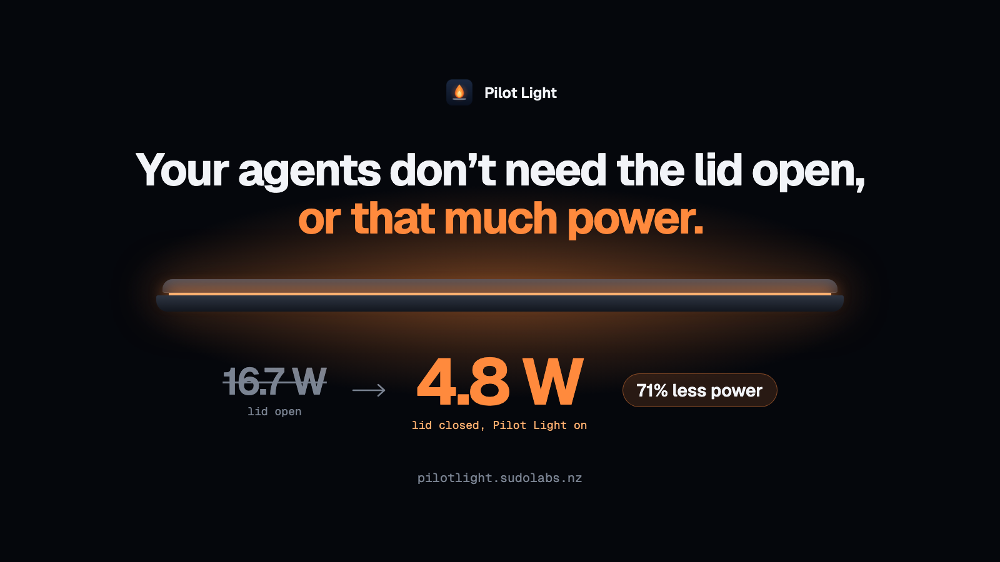

# Pilot Light (beta)

**Lid shut. Pilot light on.** A tiny macOS menu bar app that keeps your MacBook awake with the lid closed, so AI coding agents keep working, on under a third of the power.



**Website:** [pilotlight.sudolabs.nz](https://pilotlight.sudolabs.nz) · **Download:** [latest release](https://github.com/CyrisXD/pilot-light/releases/latest)

## What it does

When the lid closes while you're logged in, Pilot Light:

- keeps the Mac awake (power assertions like `caffeinate` can't survive a lid close; this uses the system sleep setting that can),
- switches to Low Power Mode, then restores your exact battery and charger settings when the lid opens,
- turns the display off,
- lets the Mac sleep anyway on serious heat or when the battery drops below your limit.

Log out or switch users and closing the lid sleeps the Mac as normal. The menu shows your Mac's own measured power draw with the lid open and closed.

Once a day it checks GitHub for a newer release and shows **Update available** in the menu if there is one. That's its only network request, and you can turn it off with **Check for updates daily**.

| | Measured¹ |
|---|---|
| Lid open | 16.7 W · ~6 h battery |
| Lid closed, Pilot Light on | 4.8 W · 20+ h battery |
| App memory | ~25 MB |
| App CPU while waiting | ~0% |
| Download | 900 KB |

¹ MacBook Pro with M5 Max (macOS 26.6), on battery. With Claude Code building and testing a website, lid closed: 2.3 W. Heavy local builds draw more, and battery hours are estimates.

## Install

1. Download the latest release and drag **Pilot Light** to Applications. It isn't notarized yet: the first time you open it, go to **System Settings › Privacy & Security** and click **Open Anyway**.
2. Click the flame in the menu bar, then **Install helper (admin)…**. This one admin prompt adds a sudoers rule that allows only `pmset` sleep and Low Power changes.
3. Close the lid.

While Pilot Light is on, the Mac also won't idle-sleep with the lid open (the display still turns off).

If Pilot Light crashes or is force-quit, a small background check (installed with the helper) turns lid-close sleep back on within a minute.

## Uninstall

Choose **Remove helper…** from the Pilot Light menu, quit the app, and drag it to the Bin. To remove the helper by hand instead: `sudo rm /etc/sudoers.d/pilotlight`.

## Beta

Pilot Light is in public beta. The heat and battery cutoffs have only been tested on one Mac so far. If something doesn't behave as described, please [open an issue](https://github.com/CyrisXD/pilot-light/issues/new).

## Build from source

```bash
git clone https://github.com/CyrisXD/pilot-light
cd pilot-light
./build.sh
open ~/Applications/"Pilot Light.app"
```

Needs the Xcode command line tools. Builds a universal app (Apple silicon and Intel) for macOS 13 and later. The whole app is [`main.swift`](main.swift). Run `PilotLight --selftest` to check the core logic.

`measure.sh` logs whole-Mac power from battery telemetry if you want to reproduce the numbers: `./measure.sh closed-batt 10`.

## Support development

Pilot Light is free. If it keeps your agents running, you can [sponsor on GitHub](https://github.com/sponsors/CyrisXD) or [buy me a coffee](https://buymeacoffee.com/FiRmVXOZh).

## License

MIT © sudolabs
